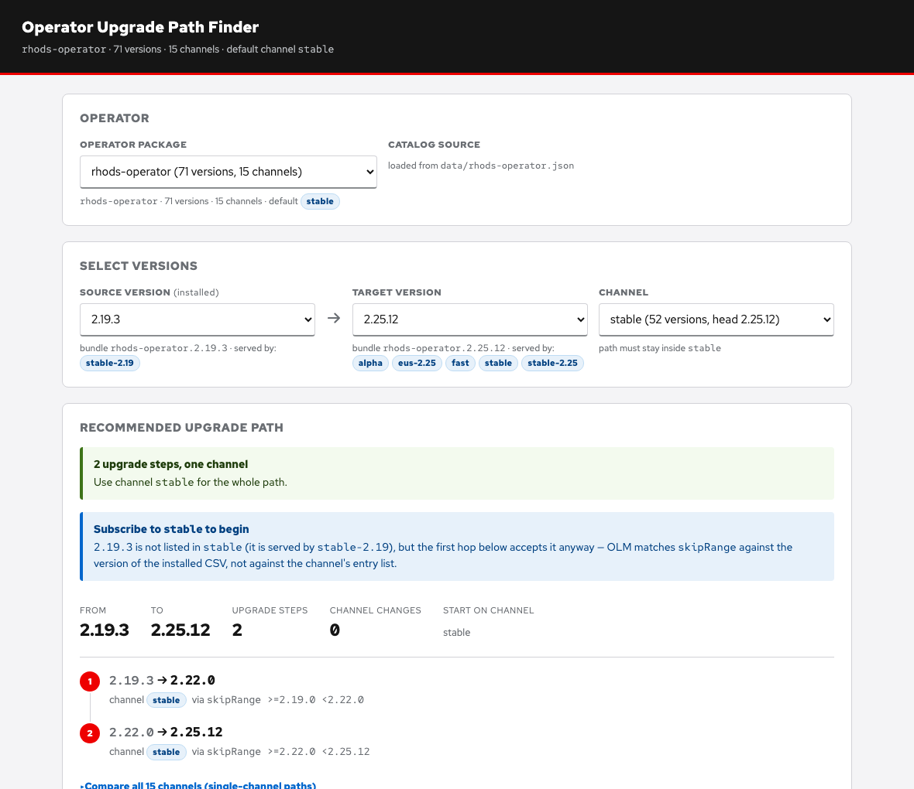

# Operator Upgrade Path Finder

## Disclaimer

This project or the binary files available in the `Releases` area are `NOT` delivered and/or released by Red Hat. This is an independent project to help customers and Red Hat Support team to check what should be the hops whenever doing an Operator Upgrade.

---

A single-page tool for answering one question: **if an operator is on version X, how does it get to version Y?**

Pick an operator, a source version and a target version, and the page computes the upgrade path from the operator's own OLM catalog — every hop, the channel each hop runs on, and the `replaces` / `skips` / `skipRange` edge that permits it. It also tells you when there is no path at all, and why.

No build tooling, no dependencies, no framework. One HTML file, one shell script.



---

## Quick start

```sh
# 1. get the application
git clone https://github.com/QikfixAI/ocp_operator_upgrade_path_finder.git
cd ocp_operator_upgrade_path_finder

# 2. extract a catalog from the Red Hat operator index image
podman login registry.redhat.io -u REDHAT_USER_HERE
podman pull registry.redhat.io/redhat/redhat-operator-index:v4.16
podman create --name rhoai-catalog registry.redhat.io/redhat/redhat-operator-index:v4.16
podman cp rhoai-catalog:/configs /tmp/catalog
podman rm rhoai-catalog
mv /tmp/catalog ./catalog

# 3. build the slim index (~4 seconds)
./build-index.sh

# 4. (RHEL, only if reaching it from another machine) open the port
sudo firewall-cmd --permanent --add-port=8000/tcp
sudo firewall-cmd --reload

# 5. serve and open
python3 -m http.server 8000
#    local  : http://localhost:8000/
#    remote : http://<server-ip>:8000/
```

Match the image tag to your cluster's OpenShift version (`v4.14`, `v4.16`, `v4.19`, …).

The same steps are built into the page itself — the **Setup & data refresh** button, or `index.html#setup`.

---

## Why there is a build step

The catalog tree is big. A current `redhat-operator-index` is around **1.6 GB** across 167 operators, and single files are enormous: `openshift-gitops-operator/catalog.json` is **220 MB**, `ansible-automation-platform-operator` is 180 MB. Almost all of that is `olm.bundle` records carrying every bundle's manifests as base64.

None of it matters for upgrade paths. Only `olm.package` and `olm.channel` records describe the upgrade graph. `build-index.sh` streams past everything else and writes one small file per operator:

| | before | after |
|---|---|---|
| whole tree | 1.6 GB | **1.1 MB** |
| rhods-operator | 13 MB | 50 KB |
| openshift-gitops-operator | 220 MB | 42 KB |

That makes switching operators in the UI instant instead of a multi-second download and parse.

---

## Files

| path | role |
|---|---|
| `index.html` | the whole application — UI, OLM semantics, path finding |
| `build-index.sh` | distils `catalog/` into `data/` |
| `e2e-test.sh` | end-to-end test: build output, HTTP serving, every operator in a browser |
| `version.conf` | the application version |
| `version.js` | generated from `version.conf`; lets the footer show a version over `file://` |
| `catalog/` | the extracted catalog, one sub-directory per operator |
| `data/` | generated index: `operators.json` + one file per operator |

---

## `build-index.sh`

```
./build-index.sh [catalogDir] [outDir]        defaults: ./catalog ./data
./build-index.sh --engine jq catalog data     force a specific engine
./build-index.sh --version-only               refresh version.js only
./build-index.sh --help
```

It needs **`python3`** (default) or **`jq`**. It does the directory walking, layout detection and output assembly in shell, and delegates only the JSON scanning — because that part has to be fast:

| engine | 14 MB catalog |
|---|---|
| BSD `awk`, character scan | **> 10 min** |
| `perl` | 2.5 s |
| `jq` | 0.13 s |
| `python3` | 0.08 s |

Pure shell/awk is not viable at this scale: the files are not line-oriented (rhods is a single 14 MB line), so a real brace-depth scan is unavoidable, and BSD `awk` is orders of magnitude too slow for it. `python3` is the default and is already required for the web server step.

### Catalog layouts

Red Hat's index image is not uniform. All five layouts present are handled:

| layout | count |
|---|---|
| `catalog.json` (JSON stream) | 146 |
| `channels/*.json` + `package.json` | 14 |
| `index.json` | 4 |
| `channels.yaml` + `package.yaml` | 2 |
| `channel.json` + `package.json` | 1 |

A file-based catalog is a *stream of concatenated JSON objects*, not a JSON document — `JSON.parse` / `json.loads` on the whole file fails. Both the script and the page split on top-level brace depth.

The YAML layouts need the `python3` engine; `--engine jq` skips them with a message.

---

## Running without the index

If `data/` is absent the page still works. It discovers operators by parsing the web server's directory listing of `catalog/`, then stream-parses the catalog you select, discarding bundle bytes as they go past so memory stays bounded. Measured on the 218 MB file: **1.4 s, 2 MB heap growth.**

It is slower and re-reads the file on every switch, so the index is worth building. This path also cannot read the two YAML operators — it says so and points at the script.

---

## How the upgrade path is computed

Inside a channel, OLM allows an upgrade from A to B when B declares any of:

- `replaces: A`
- `skips: [… A …]`
- `skipRange` matching A's version

**A does not have to be an entry of that channel.** `skipRange` is matched against the version of the *installed CSV*, and `replaces`/`skips` may name bundles served by other channels. So the edge *destination* must be a channel entry, but the *source* may be any bundle in the package. This is not a technicality — it is what makes most real upgrades possible; see [the worked example below](#under-the-hood--tracking-the-hops-using-rhoai-as-an-example).

Path finding is Dijkstra over `(version, channel)` states: it minimises upgrade hops first, then channel switches. A channel switch is shown as its own step, because it is a real action — editing `spec.channel` on the Subscription.

Version comparison follows `blang/semver`, which is what OLM uses: plain comparison with pre-release ordering, and no npm-style exclusion of pre-releases from ranges. Bundle names are normalised across the `name.1.2.3` and `name.v1.2.3` conventions both of which appear in the index.

### What it reports

- the recommended path, hop by hop, with the channel and the edge reason
- whether a direct upgrade is possible
- a comparison of all channels, showing the single-channel path through each
- everything reachable from the source in one hop
- downgrades, flagged as unsupported by OLM
- genuine dead ends — e.g. `rhods-operator` 2.16.5 and 2.10.2 are terminal z-stream versions with no outgoing edge anywhere in the catalog

---

## Under the hood — tracking the hops, using RHOAI as an example

Take `rhods-operator` going from **2.19.3** to **2.25.12**. The app shows two hops on `stable`, and the reason is worth following, because the hops are not arbitrary — they are forced by which `skipRange` windows contain 2.19.3.

### Why you cannot stay put

2.19.3 only appears in `stable-2.19`, and that channel **ends at 2.19.3**. There is no entry above it, so no upgrade is possible without pointing the Subscription somewhere else first.

### On `stable` — two hops

```
2.19.3 ──► 2.22.0 ──► 2.25.12
```

| hop | accepted by | rule |
|---|---|---|
| 2.19.3 → 2.22.0 | `2.22.0` | `skipRange: >=2.19.0 <2.22.0` |
| 2.22.0 → 2.25.12 | `2.25.12` | `skipRange: >=2.22.0 <2.25.12` |

2.19.3 sits inside `>=2.19.0 <2.22.0`, so 2.22.0 accepts it. It does **not** sit inside `>=2.22.0 <2.25.12`, so 2.25.12 rejects it. That single fact is why 2.22.0 is an unavoidable stepping stone: it is the only entry in `stable` that will take 2.19.3, and landing on it is what makes the cluster eligible for 2.25.12.

Note that 2.19.3 is not listed in `stable` at all, and does not need to be — `skipRange` is matched against the version of the installed CSV, not against the channel's entry list. That is what the page's *"Subscribe to stable to begin"* note is telling you.

### On `eus-2.25` — one hop

The `eus-2.25` copy of 2.25.12 carries `skipRange: >=2.16.0 <2.25.12`, which already covers 2.19.3, so it goes **straight there** with no intermediate version. That is exactly what EUS channels exist for. Leave the channel selector on **Any channel** and the app finds this automatically, since it minimises hops first.

---

## Testing

```sh
./e2e-test.sh                 # full run, ~17 seconds
./e2e-test.sh --no-browser    # skip the browser phase
./e2e-test.sh --keep          # keep the temp workspace for inspection
```

Three phases, exiting non-zero on any failure:

1. **build** — runs `build-index.sh` into a temp directory and checks it produced everything it should: `operators.json`, one data file per catalog sub-directory, no orphans, valid JSON throughout, required keys present, and per-operator channel/version counts that agree with the index. Also checks `version.js` matches `version.conf`.
2. **serve** — starts a web server on a free port and asserts `HTTP 200` for the page, `version.conf` and the index files.
3. **browser** — loads the page once in headless Chrome and drives **every** operator through the real UI: select it, then render oldest→newest, newest→oldest, same→same, no-source, and once pinned to each of its channels. It fails on any thrown error, any uncaught JS error or unhandled rejection, and any operator that does not finish. It ends with a known-path assertion (`rhods-operator` 2.19.3 → 2.22.0 → 2.25.12 on `stable`, 2 steps).

A current run is 22 checks over 167 operators and 6312 versions in one browser session.

The working tree is not modified — the index goes to a temp directory and is served from a temp root of symlinks, so your own `data/` is left alone. The browser phase is skipped with a clear notice if no Chrome/Chromium is found.

---

## Versioning

`version.conf` is the single source of truth. It holds a bare version:

```
1.0.0
```

The footer resolves it from three places, best first:

1. **`version.conf`, read live** — always current, needs HTTP
2. **`version.js`** — works when the page is opened from disk, where browsers block `fetch()` of a sibling file but allow `<script src>`
3. **`data/operators.json`** — recorded at index build time

Over HTTP the live file wins, so bumping `version.conf` shows up on refresh with nothing to regenerate. For the `file://` case, refresh the generated copy:

```sh
./build-index.sh --version-only
```

---

## Notes

- The page must be served over HTTP. Browsers block `fetch()` on `file://`, so opening `index.html` directly shows the setup steps and the version, but cannot load a catalog.
- Directory-listing discovery (the no-index path) needs a server with autoindex enabled. `python3 -m http.server` has it; nginx and GitHub Pages do not, so build the index for those.
- `catalog/` and `data/` are generated. Only `index.html`, `build-index.sh`, `version.conf` and this file are sources.
- The selected operator is reflected in the URL (`?op=rhods-operator`), so a particular assessment is linkable.
- The **Setup & data refresh**, **Disclaimer** and **About** panels are linkable too, at `#setup`, `#disclaimer` and `#about`.

---

## Contact

Questions, doubts or ideas are very welcome — email **<waldirio@gmail.com>**.
